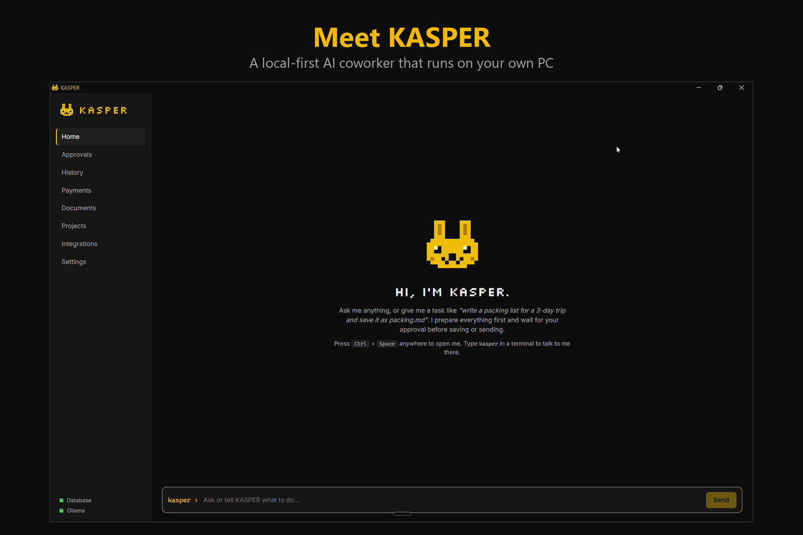
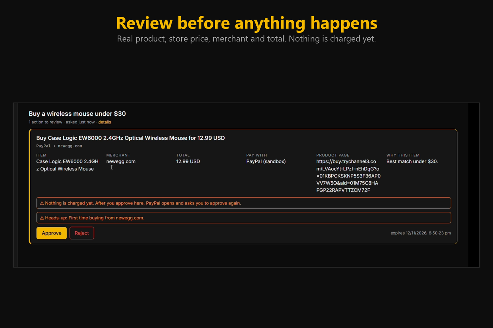
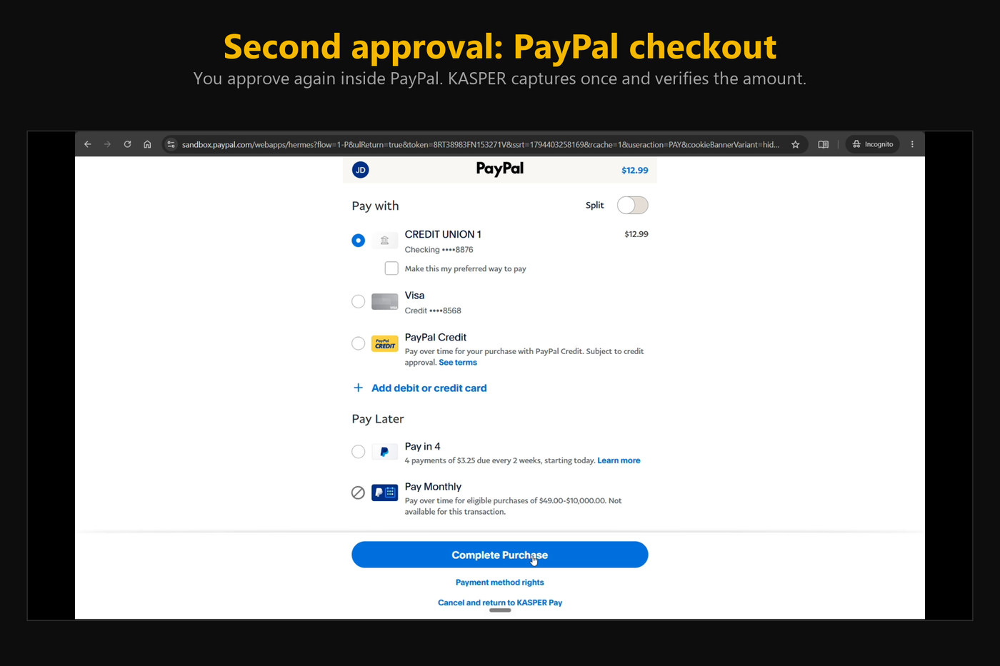
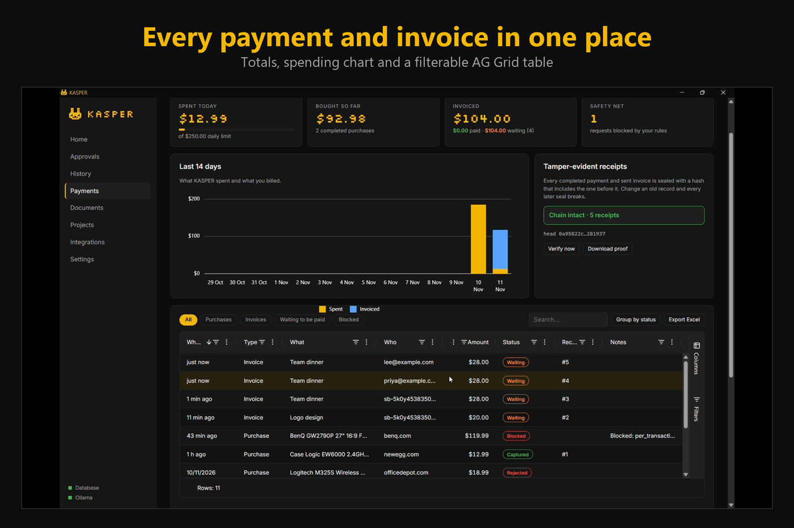
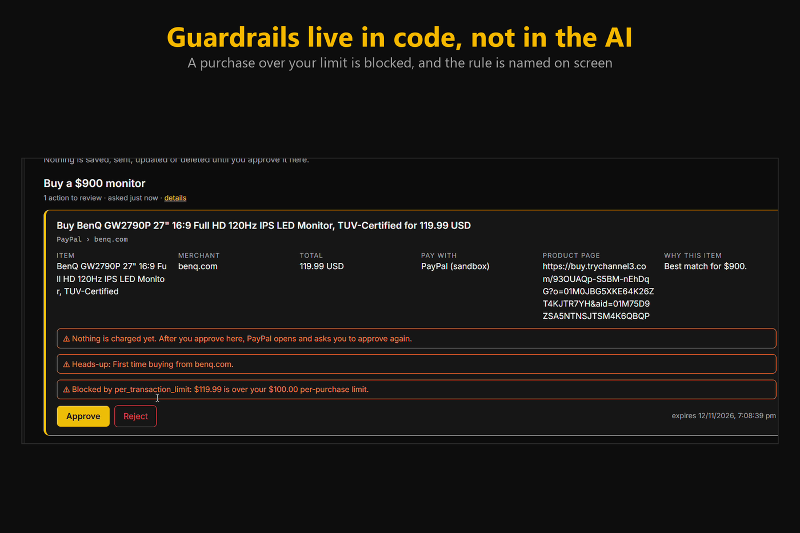
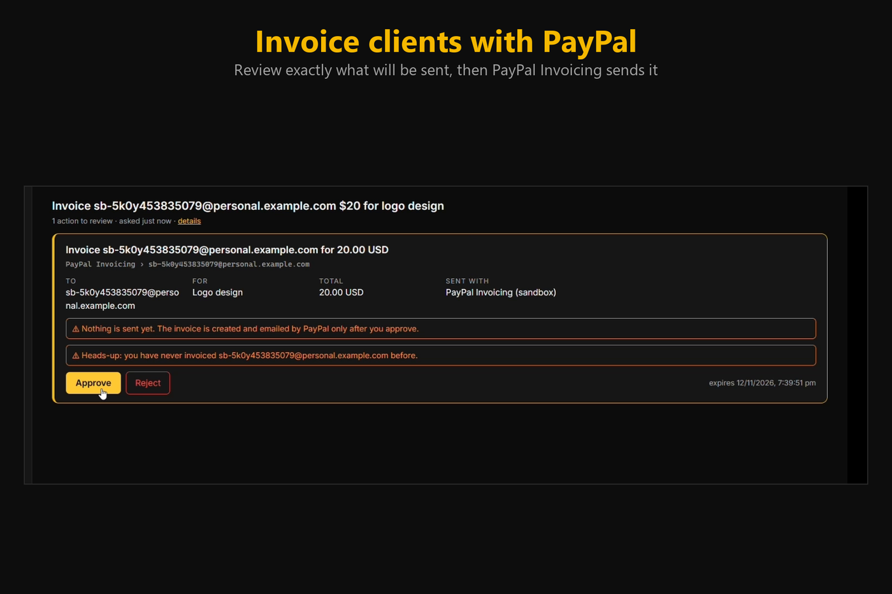
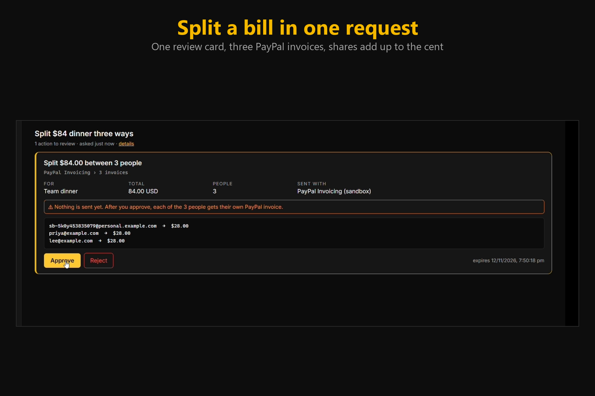
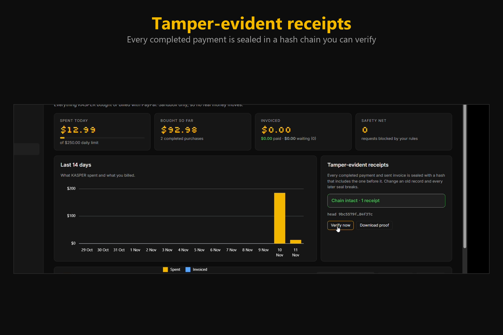

<p align="center"></p>

<h1 align="center">KASPER</h1>
<p align="center"><b>Your local-first AI coworker.</b><br>It does the work, handles money through PayPal, and waits for your approval before anything is saved, sent, paid or deleted.</p>

<p align="center">
  <a href="https://developer.paypal.com"></a>
  <a href="https://ollama.com/library/qwen3"></a>
  <a href="https://trychannel3.com"></a>
  <a href="https://www.ag-grid.com"></a>
  <a href="https://www.ag-grid.com/charts/"></a>
  <a href="docs/KASPER-Pay.postman_collection.json"></a>
</p>
<p align="center">
  <a href="https://dotnet.microsoft.com"></a>
  <a href="https://react.dev"></a>
  <a href="https://sqlite.org"></a>
  <a href="https://www.notion.so"></a>
  <a href="https://slack.com"></a>
  <a href="https://github.com"></a>
  <a href="LICENSE"></a>
</p>

---

<!-- Add the YouTube link once the video is public, then uncomment:
<p align="center"><b><a href="PASTE_YOUTUBE_LINK_HERE">Watch the 3-minute demo</a></b></p>
-->

## Screenshots

<p align="center"> </p>
<p align="center"> </p>
<p align="center"> </p>
<p align="center"> </p>


## What it does

KASPER is a desktop assistant (Windows) that runs an AI model **on your own PC** and turns plain-English requests into approved actions.

**Money (new for the PayPal AI Hackathon 2026)**
- **Buy real products.** *"Buy me a wireless mouse under $30."* Code searches live products, picks the best in-budget match and freezes its price. The AI never sees or sets a price.
- **Invoice and get paid.** *"Invoice alex@example.com $200 for logo design."* Then *"who hasn't paid me yet?"* and *"remind alex@example.com."*
- **Split a bill.** *"Split the $84 dinner between sam@x.com, priya@x.com and lee@x.com"* becomes one review card and three PayPal invoices. The shares add up to the cent.
- **Spending mandate.** Optionally let KASPER skip its own review card for small purchases. PayPal still asks you to approve every payment.
- **Risk heads-ups and tamper-evident receipts** on every payment (details below).

**Everyday work**
- Write and save files, **convert and edit documents** (Office, PDF, Markdown, HTML, EPUB; merge, rotate, compress, OCR), manage **projects and tasks**, and work with **Notion**, **Slack** and **GitHub**.
- Everything that saves, sends, updates, pays or deletes stops at **Final Review** first (see [How Final Review works](#how-final-review-works)).
- A `kasper` command for any terminal, a tray icon and a `Ctrl+Space` hotkey.

Docs: [architecture](docs/architecture.md) · [threat model](docs/threat-model.md) · [connect services](docs/provider-setup.md) · [document engines](docs/engines.md) · [PRD status](docs/prd-status.md)

## PayPal integration

KASPER Pay uses the PayPal developer platform (sandbox) in four places:

| PayPal capability | What KASPER uses it for |
|---|---|
| **OAuth** (client credentials) | Gets and caches an access token, refreshed before it expires. Credentials never leave the PayPal call. |
| **Orders v2** | `create` an order for the approved product, `get` it to see when you approved it in PayPal, then `capture` once and verify status, amount and currency. |
| **Invoicing v2** | `create` a draft and `send` it (single invoices and bill splits), `get` it to learn whether it was paid, and `remind` unpaid ones. |
| **Idempotency** (`PayPal-Request-Id`) | Create and capture calls can be repeated safely, so a double click or restart never charges twice. |

How a purchase flows:

```text
You ask → local AI (Qwen via Ollama) plans: find a product, then buy it
        → code searches products and freezes the price (the AI only supplies words and a budget)
        → code checks your spending rules (Blocked, with the rule name, if broken)
        → Final Review in KASPER (approval is bound to item, amount, currency, merchant)
        → PayPal order is created and the PayPal page opens
        → you approve again inside PayPal → KASPER captures once and verifies the amount
        → sealed into your receipts and shown in Payments
```

Every PayPal call KASPER makes is in the [Postman collection](docs/KASPER-Pay.postman_collection.json).

## How AI is used

| Where | Tool | What it does |
|---|---|---|
| Planning | **Qwen3 8B through [Ollama](https://ollama.com)**, running locally | Turns a request into a short plan of registered tools, as strict JSON that code validates (one repair retry). |
| Product search | **[Channel3](https://trychannel3.com)** API | Live product search for "buy me…" requests. The AI supplies only the words and budget. |
| Payments table and chart | **[AG Grid](https://www.ag-grid.com)** and **AG Charts** | The Payments screen: filter, search, group, export, spending chart. Enterprise features switch on with an optional license key; without one it runs as the community grid. |
| API testing | **Postman** | A collection of every PayPal request KASPER makes. |

**What the AI cannot do:** it never decides prices or totals, never calls PayPal, never sees credentials, and cannot approve anything. Approvals only come from you.

## Safety model

- The model only picks a product to look for or fills invoice details. Prices, totals and currency come from code and are bound into the approval, so changing the amount, item, currency or recipient after approving invalidates it.
- **Guardrails run in code**, when the request is made and again just before PayPal is called: per-purchase limit, daily limit, duplicate-purchase window, optional merchant and recipient allow-lists, and USD only. A broken rule shows as **Blocked** with its name, and nothing is created in PayPal.
- **Two approvals:** KASPER's Final Review, then PayPal's own approval by the buyer. A capture that doesn't match what you approved is marked Failed.
- **Spending mandate (optional):** small purchases up to your limit and weekly cap skip KASPER's card; PayPal still asks, and every guardrail still applies.
- **Risk heads-ups:** first-time merchants or recipients, amounts far above your usual, and amounts near your limit are flagged on the review card. These come from code, not the AI.
- **Tamper-evident receipts:** each completed payment and sent invoice is sealed in a hash chain. *Verify* on the Payments screen shows "chain intact" or the first record that changed, and you can download the proof. It detects edits; someone with full control of your PC could rebuild the whole chain.
- Replays are safe: one payment per step, request ids on PayPal calls, and an invoice is sent at most once. Reminders are never sent for paid invoices and at most once per 24 hours.
- **Sandbox only. No real money.**

**Data boundary (exact).** The AI model, your chat, files, history and database stay on this machine. When you approve a purchase or invoice, PayPal receives what it needs: item name, SKU, amount, currency and, for invoices, the recipient email and description. With a Channel3 key set, product searches send Channel3 your search words and budget (and the key); with no key nothing is sent. Your PayPal Client ID and Secret are read from user secrets or environment variables, are sent only to PayPal in the auth header, and are never given to the model, the UI, logs or the repo.

## Setup (5 steps)

1. Install the .NET 10 SDK, Node.js and [Ollama](https://ollama.com), then run `ollama pull qwen3:8b`.
2. Create a PayPal sandbox app and sandbox accounts at [developer.paypal.com](https://developer.paypal.com). Use a **United States** business account for the app and a **United States** personal account as the buyer, otherwise checkout fails on currency. When you create the app, open its **Features** and tick **Accept payments** and **Invoicing**, then click **Save Changes** (without Invoicing, invoice features fail with a permission error).
3. Store the app credentials (see [.env.example](.env.example)):
   ```powershell
   dotnet user-secrets set "PayPal:ClientId" "<sandbox client id>" --project src/Kasper.Api
   dotnet user-secrets set "PayPal:ClientSecret" "<sandbox secret>" --project src/Kasper.Api
   dotnet user-secrets set "PayPal:Environment" "sandbox" --project src/Kasper.Api
   ```
   Optional, for live products: `dotnet user-secrets set "Channel3:ApiKey" "<key>" --project src/Kasper.Api`. Without it KASPER searches 8 built-in demo products.
4. Build and run: `cd ui; npm ci; npm run build; cd ..; dotnet run --project src/Kasper.Desktop` (or use `install.ps1`, below).
5. Ask KASPER: *"buy me a wireless mouse under $30"*. Approve it, then log in as the **sandbox buyer** (use a private window) on the PayPal page that opens.

Spending limits and the mandate are editable on the **Payments** screen. The demo script and Devpost text are in [docs/paypal-demo.md](docs/paypal-demo.md).

## How Final Review works

1. You ask: *"write a packing list for a weekend trip and save it as packing.md"*.
2. KASPER's local model proposes a plan (write text → prepare file → save file). The server checks it: only registered tools, valid inputs, allowed folders, no invented paths.
3. Safe steps run straight away. Anything that **saves, sends, updates, pays or deletes** is prepared in a private staging folder and waits.
4. You get a notification. The Approvals screen (or `kasper review`) shows exactly what will happen: file name, destination, amount and content. You can **Approve**, **Edit** or **Reject**.
5. Right before acting, KASPER checks that nothing changed since you approved. If something changed, it asks again. Files are never overwritten; a copy gets a "(2)" suffix instead.

Tasks survive restarts. Temporary failures are retried a few times, and every step is recorded in History.

## Install (for daily use)

Needs the .NET 10 SDK, Node.js and [Ollama](https://ollama.com) with a model (default `qwen3:8b`).

```powershell
powershell -ExecutionPolicy Bypass -File .\install.ps1
```

This publishes KASPER to `%LOCALAPPDATA%\Programs\KASPER`, adds it to your user PATH and creates a Start Menu shortcut. Open a **new** terminal and type:

```text
kasper                 # talk to KASPER (pixel bunny banner + prompt)
kasper ask "..."       # one-shot question or task (follows it and asks for approval)
kasper convert a.docx --to pdf          # convert (any to any, with engines installed)
kasper pdf merge a.pdf b.pdf -n all.pdf  # also: pages -p 1-3 | rotate -d 90 | compress -q low | images
kasper approvals       # what's waiting for you
kasper review [id]     # approve / edit / reject, with a full preview
kasper status [id]     # recent tasks, or one task's step-by-step trace
kasper cancel <id>     # stop a task
kasper open            # open the desktop window
kasper doctor          # check Ollama, database and document engines
kasper --help
```

`kasper` starts the desktop app in the background if it isn't running. Remove everything with `.\uninstall.ps1` (add `-RemoveData` to also delete your local data).

## Settings

Optional `%LOCALAPPDATA%\KASPER\settings.json`:

```json
{ "Ollama": { "Model": "qwen3:8b", "BaseUrl": "http://127.0.0.1:11434", "TimeoutSeconds": 300, "KeepAlive": "30m" } }
```

Environment variables work too (`KASPER__Ollama__Model=...`, see [.env.example](.env.example)). Data, logs and the database live in `%LOCALAPPDATA%\KASPER`.

## Document engines

Merge, pick pages, rotate, compress (lossless) and images → PDF are built in. For other conversions install the free engines (`kasper doctor` lists what is missing):

```powershell
winget install TheDocumentFoundation.LibreOffice   # Office <-> PDF, PDF -> Word
winget install JohnMacFarlane.Pandoc               # Markdown, HTML, DOCX, EPUB
winget install ArtifexSoftware.GhostScript         # stronger PDF compression
```

## Connect Notion

1. Create an internal integration at notion.so/profile/integrations and copy its secret.
2. In your task database: ••• → Connections → add the integration.
3. KASPER → Integrations → paste the secret and the database link. The secret is encrypted with Windows DPAPI for your account.

## Develop

```powershell
cd ui; npm install; npm run build; cd ..     # UI is served from the desktop app
dotnet build Kasper.sln
dotnet test                                    # 200+ tests, no Ollama or accounts needed
.\src\Kasper.Cli\bin\Debug\net10.0\kasper.exe  # finds the Debug desktop build automatically
```

Optional: put an AG Grid Enterprise key in `ui/.env.local` as `VITE_AG_GRID_LICENSE=...` (gitignored) to enable the Enterprise grid features.

Logo: edit [assets/brand/kasper-logo.grid.txt](assets/brand/kasper-logo.grid.txt), then run `node assets/brand/render-logo.mjs` to regenerate the SVG, terminal art and `.ico`. The UI and CLI read the grid directly.

## Layout

```text
src/Kasper.Domain          entities and rules (workflow and payment state machines, approval policy)
src/Kasper.Application     interfaces, contracts, options, prompts, spending guardrails
src/Kasper.Infrastructure  Ollama, SQLite (EF Core), workflow engine + worker, tools, planner, PayPal, Channel3
src/Kasper.Api             local HTTP API (127.0.0.1 only, per-launch token)
src/Kasper.Desktop         WPF + WebView2 window, tray, hotkey, notifications
src/Kasper.Cli             the `kasper` command (Spectre.Console)
ui/                        React + TypeScript + Vite (AG Grid, AG Charts)
tests/Kasper.UnitTests     domain, adapter, payment and API tests
```

## Security basics

- The API listens on `127.0.0.1` only, needs a random token that changes every launch, and rejects non-loopback `Host` headers.
- The token is kept in `session.json`, which only your Windows user can read, and is never logged.
- Only `user`/`assistant` messages are accepted; KASPER's system prompt can't be replaced by callers.
- Secrets (PayPal, Channel3) come from user secrets or environment variables, never from files in the repo.

## Troubleshooting

| What you see | Why, and what to do |
|---|---|
| PayPal checkout says *"This seller doesn't accept payments in your currency"* | Your sandbox accounts aren't US accounts (India accounts are INR-only). Create a **US business** and a **US personal** sandbox account, create the app under the US business, and log in as the US personal buyer. |
| PayPal checkout says *"Things don't appear to be working"* or *"logged in elsewhere"* | Open the checkout link in a **private window** and log in with the **sandbox personal** account, never your real PayPal login. Don't reuse an old link: ask KASPER again. |
| Invoice rows show **Failed** with *"PayPal rejected the request. Check the sandbox credentials and app permissions."* | The app doesn't have the Invoicing permission. Tick **Invoicing** under the app's **Features**, click **Save Changes**, then restart KASPER (it caches the token). If it still fails, create a new app with Invoicing ticked and use its credentials. |
| Buying shows "KASPER Demo Store" products only | No Channel3 key is set, so KASPER searches the 8 built-in products. Set `Channel3:ApiKey` (step 3) and restart for live products. |
| A request is **Blocked** | One of your spending rules stopped it (the rule name is shown). Change the limits on the **Payments** screen, or wait out the 10-minute duplicate window. |
| The Payments screen shows an error or the chart is missing | Rebuild the UI (`cd ui; npm ci; npm run build`) and restart the app. |
| KASPER doesn't see new secrets or settings | Fully quit it (including the tray icon) and start it again. |

## License

[MIT](LICENSE)
